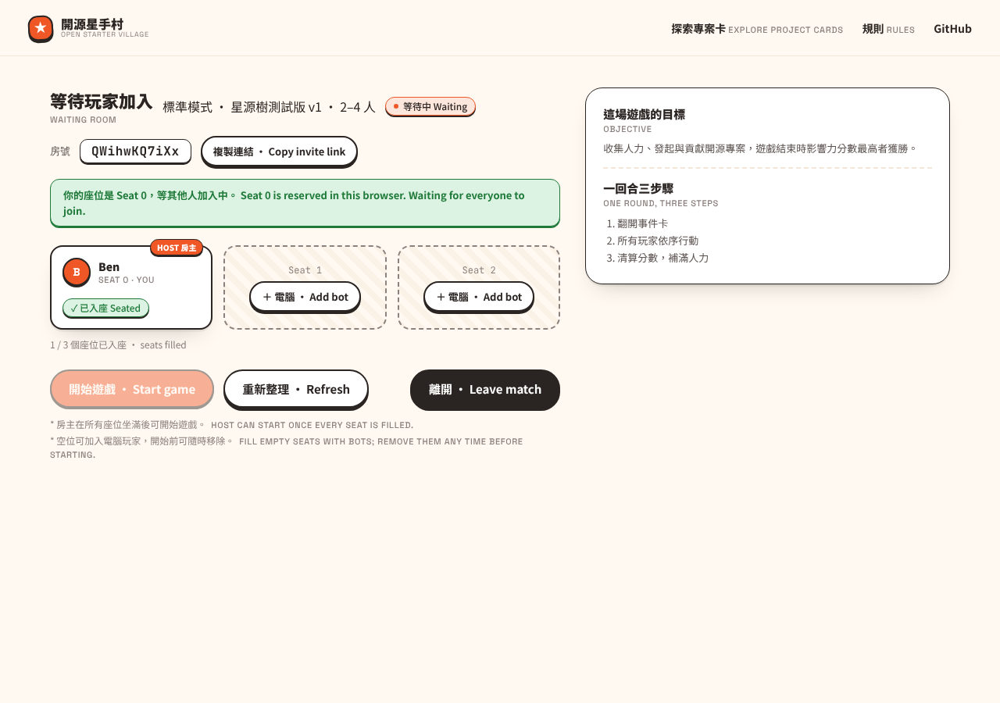
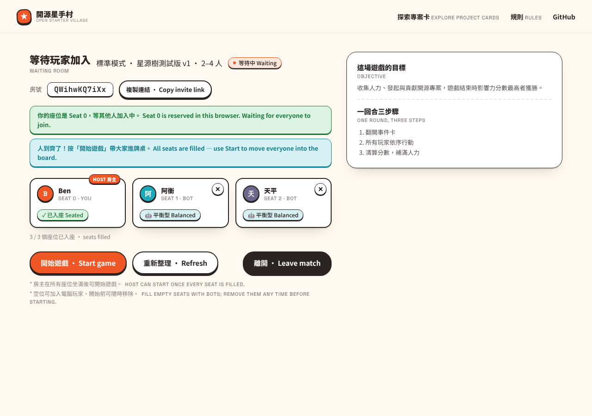
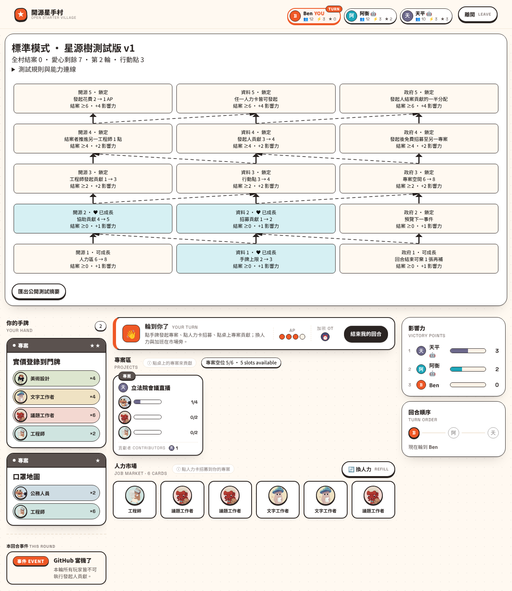
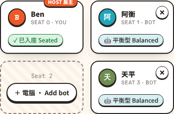

# Bot seats in game rooms — evidence

Runtime commit `7544b25`, 2026-10-27, Node 22.22.0, Chromium (Playwright).

## Setup

- **Game server:** `NODE_ENV=production`, `PORT=3291`,
  `GAME_SERVER_ORIGINS=http://localhost:3290`, `BOT_MOVE_DELAY_MS=300`.
- **Web app:** Next dev server on port 3290 pointing at that game server.
- Each room is a 3-player Standard room created through the lobby REST API.
  The host "Ben" joined seat 0, and the browser loaded Ben's saved seat
  credential.

## Scenario and result

1. **Host waiting room, empty seats.** Seats 1 and 2 each show
   **＋ 電腦 · Add bot**, and Start is disabled.
   
2. **Add a bot to seat 1, then seat 2.**
   - The seats became 阿衡 and 天平, each showing `SEAT n · BOT` and
     `🤖 平衡型 Balanced` with a ✕ remove control.
   - All seats count as filled, so Start became available.
   
3. **Remove the seat 2 bot, then add it again.** The seat emptied, then
   refilled.
4. **A second browser with no saved seat** saw both bot seats and 0
   add/remove controls.
5. **Lobby API after start.** `GET /games/OpenStarTerVillage/<id>` returned
   bot seats with `data.bot.strategy = "balanced"` and no `credentials`
   field for any seat.
6. **Start the game.**
   - The game server logged `bot <id>:1 (balanced) started` and
     `bot <id>:2 (balanced) started`.
   - Ben ended turn 1 (end turn, then confirm). Both bots then played their
     turns, and Ben's turn came back as round 2 after 1.3–1.8 s.
   - The board shows each bot's started project with contributions, 2
     points each, and the 數位政委 choices resolved by the bots. The
     scoreboard and turn order show `阿衡 🤖` and `天平 🤖`.
   
7. **The solo host leaves the board for the lobby.**
   - The game server logged both bots `stopped`, because no human had a
     live socket.
   - The host's lobby shows the room with **回到桌子 · Return**. The second
     browser with no seat does not see the room (0 rows).
   - Return reopened the board, and the server logged both bots `started`
     again.
   
8. **390×844 viewport, 4-player room with bots in seats 1 and 3.** No
   horizontal overflow (0 px). The ✕ control's 44×44 hit area sits in the
   card's top-right corner, around a 26 px visual.
   

## Automated coverage

`src/botSeats.test.ts` runs a real in-process boardgame.io server.

- **Rejected requests:**
  - **403:** a non-host, or a wrong host credential.
  - **400:** the host seat, a seat outside the room, an unknown strategy, or
    a Simplified room.
  - **409:** a taken seat or an already-started game.
  - The host also cannot remove a human seat.
- **Full game:** a server bot plays a full 2-player Standard game against a
  test client in the host seat, reaching game over in round 7.
- **Stopping and pausing:**
  - The runner stops the bot at game over, or when a human leaves mid-game
    and the match is terminated.
  - It pauses bots while no human has a live socket.
  - It keeps them running when one of a human's sockets closes but another is
    live (boardgame.io's stored flag goes stale there, so it checks live
    sockets).
- **Cleanup:** a room is deleted once only bots are seated in it.
- **Spoofing:** a seat whose player set `data.bot` without a server bot
  credential is not played and cannot be removed as a bot.
