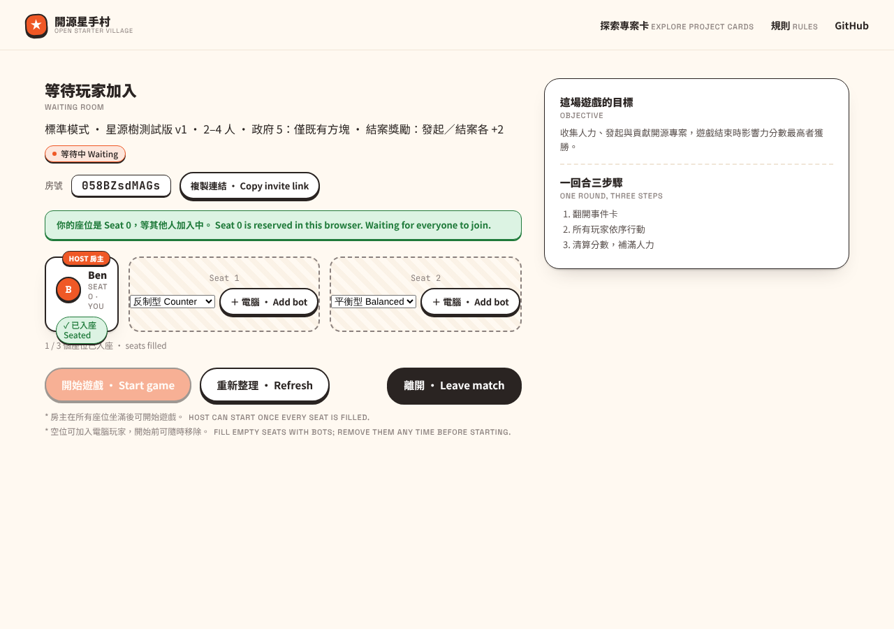
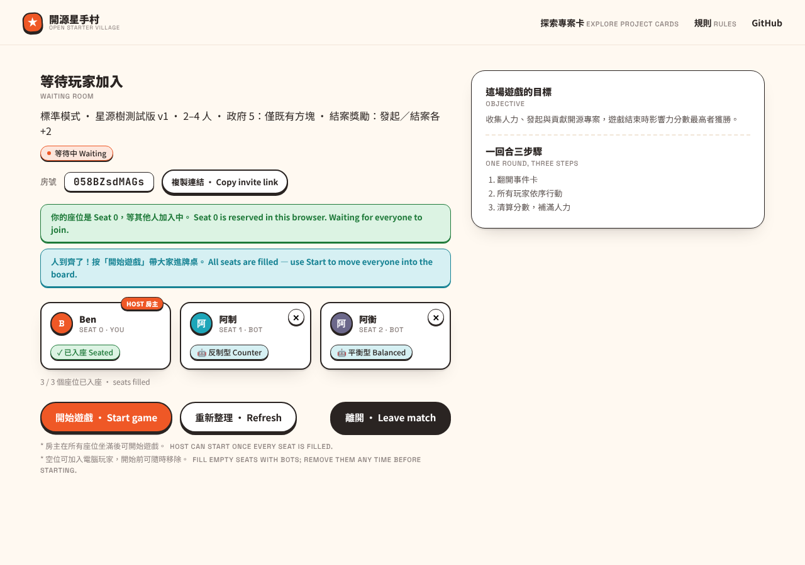
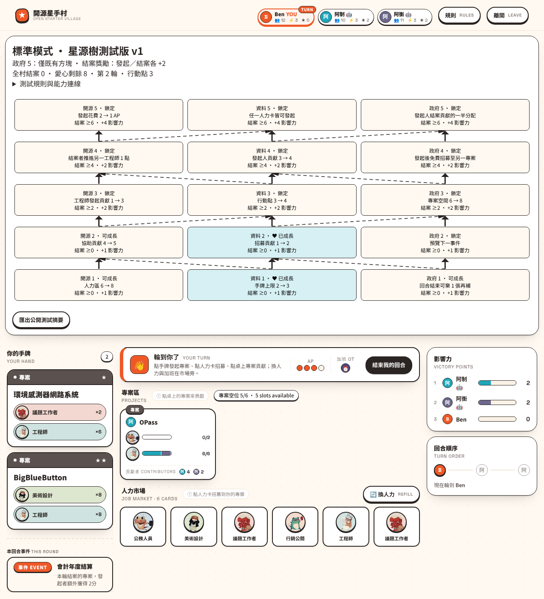

# 反制型 Counter 對 Balanced：36,000 場配對測試

2026-10-28。結論：**反制型在先手的第 1、2 位都明顯贏過 Balanced**。在原規則 A 的 2、3、4 人局，兩個座位的 95% 勝率區間下界都高於 1/N，達成目標。B、C、D 也都大幅提升；唯一沒達標的是 **B 四人局第 1 位**（25.0%，區間 22.4%～27.7%）。勝率提升主要來自兩點，缺一不可：少投資共享的星源樹，以及替開案設下 1 分門檻。省下的行動用來完成自己的專案並當收尾者，自己的 2★ 專案完成率約翻倍。

## 策略

反制型就是 Balanced 的權重檔 `COUNTER`（[profiles.ts](../../../../src/game/bots/profiles.ts)），只改四個權重，不另外寫機器人邏輯。它和 Balanced 一樣只看自己的玩家視角（自己的手牌與公開資訊），每個種子結果固定。

| 權重 | Balanced | 反制型 | 用意 |
| --- | ---: | ---: | --- |
| `village` | 0.3 | 0 | 不計星源樹能力帶給其他玩家的好處（全村結案仍算一半價值） |
| `unlock` | 0.5 | 0 | 不計成長後解鎖的上層節點 |
| `tree` | 1 | 0.6 | 星源樹節點價值打折，行動優先投入專案 |
| `initiation` | 0 | −1 | 開專案要先扣 1 分，只開值得開的，行動優先用來完成專案 |

這四個值是在**另外幾批種子**（`exp-*`、`search-*`、`alt-*`，主要是 3、4 人第 1 位，每組 300～1,000 場，只用規則 A）上用格點搜尋選出的。下面的正式測試使用沒參與調參的 `bot-strategies-v1` 種子。

## 方法與可重現資料

- 2、3、4 人 × 規則 A／B／C／D × 1,000 個種子。每個種子跑三次：全員 Balanced；反制型坐第 1 位；反制型坐第 2 位。其他座位一律是 Balanced。
- 共 **36,000 場，全數完成，0 失敗**。
- 同一種子的三次遊戲，發牌、事件和 Balanced 的平手抽籤都相同；分析程式逐場核對事件序列。
- 遊戲由正式 authoritative reducer 執行，沒有修改規則或 Balanced。

| 組合 | 政府 5 分配 | 發起／結案獎勵 |
| --- | --- | --- |
| A：原規則 | 自己的既有方塊 | 各 +2 |
| B | 可新增自己的方塊；每個新方塊花 1 庫存 token | 各 +2 |
| C | 自己的既有方塊 | 各依專案星數 +1～+4 |
| D | 可新增自己的方塊；每個新方塊花 1 庫存 token | 各依專案星數 +1～+4 |

- [Manifest：版本、時間、種子規則與兩個 profile 的完整權重](manifest.json)。測試 checkout 為 `404c207b`，工作目錄無未提交變更。
- [全部 36,000 場壓縮 JSONL](games.jsonl.gz)：每場的種子、組合、反制型座位、各座位得分、勝者、事件、各座位依星數的開案／完成／收尾數、方塊得分、樹得分、成長次數、進階抽牌與耗時。可按種子重跑。
- [完整分析與信賴區間](analysis.json)、[摘要 CSV](summary.csv)。
- [五個消融測試](ablations/)：各自有原始資料、manifest 與分析。

```sh
cd packages/webapp
pnpm exec tsx scripts/compare-bot-strategies.ts --challenger counter --games 1000 \
  --seed bot-strategies-v1 --out docs/evidence/bot-strategies/counter-1000
python3 scripts/analyze-bot-strategies.py docs/evidence/bot-strategies/counter-1000
# 消融，例如不收開案成本：
pnpm exec tsx scripts/compare-bot-strategies.ts --challenger counter --games 500 --scenarios A \
  --weights '{"initiation":0}' --out docs/evidence/bot-strategies/counter-1000/ablations/no-initiation
```

**計算方式**

- 平手時由共同勝者均分一場勝利。
- 統計單位為每場遊戲；勝率區間是約略 95% 常態區間。
- 「配對變化」是同種子、同座位下，反制型的勝率減去 Balanced 的勝率。
- 第 1、2 位對應 player ID `0`、`1`。每輪行動順序固定，所以座位就是行動順序。

**速度：** 4 核心平行跑完 36,000 場共 470 秒。單場耗時與全 Balanced 相同（四人局 59.7 ms 對 59.5 ms），沒有額外的前瞻計算。

## 勝率

達標條件：在 A 的 2、3、4 人局，第 1、2 位的 95% 區間下界都高於 1/N。

### A：原規則（目標）

| 人數 | 座位 | 1/N | 反制型勝率（95% 區間） | 同座位 Balanced | 配對變化（百分點，95% 區間） | 下界 > 1/N |
| --- | --- | ---: | ---: | ---: | ---: | :---: |
| 2 | 第 1 位 | 50.0% | **79.8%**（77.4%～82.2%） | 34.5% | +45.3（+41.5～+49.1） | 是 |
| 2 | 第 2 位 | 50.0% | **89.5%**（87.7%～91.3%） | 65.5% | +24.0（+20.8～+27.2） | 是 |
| 3 | 第 1 位 | 33.3% | **48.1%**（45.1%～51.1%） | 20.0% | +28.1（+24.2～+32.0） | 是 |
| 3 | 第 2 位 | 33.3% | **58.8%**（55.8%～61.8%） | 37.7% | +21.1（+17.0～+25.2） | 是 |
| 4 | 第 1 位 | 25.0% | **31.0%**（28.2%～33.8%） | 11.1% | +19.9（+16.6～+23.3） | 是 |
| 4 | 第 2 位 | 25.0% | **41.0%**（38.0%～43.9%） | 22.2% | +18.8（+15.0～+22.5） | 是 |

### B

| 人數 | 座位 | 1/N | 反制型勝率（95% 區間） | 同座位 Balanced | 配對變化（百分點，95% 區間） | 下界 > 1/N |
| --- | --- | ---: | ---: | ---: | ---: | :---: |
| 2 | 第 1 位 | 50.0% | **79.5%**（77.1%～82.0%） | 34.5% | +45.1（+41.2～+48.9） | 是 |
| 2 | 第 2 位 | 50.0% | **89.5%**（87.7%～91.3%） | 65.5% | +24.0（+20.8～+27.2） | 是 |
| 3 | 第 1 位 | 33.3% | **44.8%**（41.8%～47.8%） | 18.7% | +26.1（+22.3～+30.0） | 是 |
| 3 | 第 2 位 | 33.3% | **55.3%**（52.3%～58.3%） | 38.0% | +17.3（+13.2～+21.4） | 是 |
| 4 | 第 1 位 | 25.0% | **25.0%**（22.4%～27.7%） | 11.2% | +13.9（+10.7～+17.0） | **否** |
| 4 | 第 2 位 | 25.0% | **35.3%**（32.4%～38.2%） | 24.2% | +11.1（+7.2～+14.9） | 是 |

### C

| 人數 | 座位 | 1/N | 反制型勝率（95% 區間） | 同座位 Balanced | 配對變化（百分點，95% 區間） | 下界 > 1/N |
| --- | --- | ---: | ---: | ---: | ---: | :---: |
| 2 | 第 1 位 | 50.0% | **84.0%**（81.8%～86.2%） | 36.7% | +47.3（+43.7～+50.9） | 是 |
| 2 | 第 2 位 | 50.0% | **94.0%**（92.7%～95.4%） | 63.3% | +30.8（+27.6～+33.9） | 是 |
| 3 | 第 1 位 | 33.3% | **65.6%**（62.8%～68.5%） | 21.9% | +43.7（+40.0～+47.4） | 是 |
| 3 | 第 2 位 | 33.3% | **74.0%**（71.4%～76.7%） | 38.6% | +35.5（+31.7～+39.3） | 是 |
| 4 | 第 1 位 | 25.0% | **40.4%**（37.4%～43.3%） | 9.4% | +31.0（+27.7～+34.3） | 是 |
| 4 | 第 2 位 | 25.0% | **51.3%**（48.4%～54.3%） | 17.6% | +33.8（+30.1～+37.4） | 是 |

### D

| 人數 | 座位 | 1/N | 反制型勝率（95% 區間） | 同座位 Balanced | 配對變化（百分點，95% 區間） | 下界 > 1/N |
| --- | --- | ---: | ---: | ---: | ---: | :---: |
| 2 | 第 1 位 | 50.0% | **84.0%**（81.8%～86.2%） | 36.7% | +47.3（+43.7～+50.9） | 是 |
| 2 | 第 2 位 | 50.0% | **94.0%**（92.7%～95.4%） | 63.3% | +30.8（+27.6～+33.9） | 是 |
| 3 | 第 1 位 | 33.3% | **65.4%**（62.6%～68.3%） | 21.9% | +43.5（+39.8～+47.2） | 是 |
| 3 | 第 2 位 | 33.3% | **74.0%**（71.3%～76.6%） | 38.5% | +35.5（+31.7～+39.3） | 是 |
| 4 | 第 1 位 | 25.0% | **39.7%**（36.8%～42.7%） | 9.4% | +30.3（+27.0～+33.6） | 是 |
| 4 | 第 2 位 | 25.0% | **50.3%**（47.4%～53.3%） | 17.5% | +32.9（+29.2～+36.5） | 是 |

兩人局的 B 與 A、D 與 C 幾乎相同，因為兩人局很少解鎖政府 5。依星數給獎勵（C、D）時，反制型的優勢最大：Balanced 在這兩組本來就最吃虧，而反制型完成 2★ 專案的比例高出許多（見下節）。

### 房間能坐的其他座位：第 3、4 位（A，各 1,000 種子）

房間裡第 1 位永遠是房主，電腦只能坐第 2～4 位，所以另外測了第 3、4 位。方法相同，checkout `e7390985`：[第 3 位資料](later-seats/seat-3/)、[第 4 位資料](later-seats/seat-4/)。

| 人數 | 座位 | 1/N | 反制型勝率（95% 區間） | 同座位 Balanced | 配對變化（百分點，95% 區間） |
| --- | --- | ---: | ---: | ---: | ---: |
| 3 | 第 3 位 | 33.3% | **63.7%**（60.8%～66.6%） | 42.4% | +21.4（+17.5～+25.2） |
| 4 | 第 3 位 | 25.0% | **42.3%**（39.3%～45.3%） | 29.2% | +13.1（+9.3～+16.9） |
| 4 | 第 4 位 | 25.0% | **44.0%**（41.0%～47.0%） | 37.5% | +6.5（+3.4～+9.5） |

後手座位本來就占優勢，反制型的提升較小，但仍高於 Balanced。

## 為什麼會贏

### 得分來源：同種子、同座位的配對差（A）

| 人數 | 座位 | 得分 | 方塊得分 | 樹得分 | 收尾次數 | 自己的專案完成數 | 開案數 |
| --- | --- | ---: | ---: | ---: | ---: | ---: | ---: |
| 2 | 第 1 位 | +9.44（+8.86～+10.02） | +11.54（+10.95～+12.14） | −3.68（−3.87～−3.49） | +0.95（+0.86～+1.04） | +0.90（+0.84～+0.96） | −0.43（−0.50～−0.36） |
| 2 | 第 2 位 | +8.40（+7.78～+9.02） | +10.91（+10.28～+11.54） | −2.50（−2.73～−2.27） | +1.03（+0.94～+1.13） | +0.47（+0.41～+0.53） | −0.97（−1.04～−0.90） |
| 3 | 第 1 位 | +5.49（+4.98～+6.00） | +7.35（+6.82～+7.89） | −3.58（−3.86～−3.30） | +0.69（+0.60～+0.79） | +0.47（+0.40～+0.53） | +0.03（−0.04～+0.11） |
| 3 | 第 2 位 | +4.66（+4.14～+5.18） | +7.44（+6.88～+7.99） | −2.77（−3.10～−2.44） | +0.84（+0.74～+0.93） | +0.09（+0.03～+0.15） | −0.58（−0.66～−0.51） |
| 4 | 第 1 位 | +3.83（+3.34～+4.32） | +5.95（+5.48～+6.42） | −3.55（−3.84～−3.27） | +0.49（+0.40～+0.58） | +0.40（+0.34～+0.47） | +0.08（+0.00～+0.15） |
| 4 | 第 2 位 | +3.02（+2.53～+3.50） | +6.32（+5.79～+6.85） | −2.87（−3.19～−2.55） | +0.76（+0.67～+0.86） | −0.05（−0.11～+0.01） | −0.63（−0.70～−0.56） |

「方塊得分」是已完成專案中自己方塊的結算分數。未完成專案在終局只算一半，所以不在這欄。

反制型每場少拿約 2.5～3.7 分樹得分，但方塊得分多 5.9～11.5 分，收尾次數多 0.5～1.0 次。換句話說，它把原本用在星源樹的行動改投專案，讓更多專案在自己手上完成。

### 開案、完成率與星源樹（反制型／同座位 Balanced，平均每場）

| 組合 人數 | 座位 | 得分 | 開 1★ | 開 2★ | 自己的 1★ 完成率 | 自己的 2★ 完成率 | 收尾次數 | 方塊得分 | 樹得分 | 成長次數 | 進階抽牌 |
| --- | --- | ---: | ---: | ---: | ---: | ---: | ---: | ---: | ---: | ---: | ---: |
| A 2 | 第 1 位 | 55.81／46.37 | 2.81／3.20 | 1.32／1.36 | 82%／57% | 44%／11% | 2.90／1.95 | 28.55／17.01 | 2.23／5.91 | 1.49／4.26 | 0／0 |
| A 2 | 第 2 位 | 58.59／50.19 | 2.78／3.43 | 1.27／1.60 | 78%／59% | 41%／13% | 3.28／2.25 | 30.27／19.36 | 2.24／4.74 | 1.22／2.97 | 0／0 |
| A 3 | 第 1 位 | 50.79／45.30 | 2.46／2.54 | 1.07／0.96 | 83%／73% | 47%／24% | 2.81／2.11 | 26.70／19.34 | 2.43／6.00 | 1.17／3.74 | 0／0 |
| A 3 | 第 2 位 | 52.80／48.14 | 2.45／2.80 | 1.05／1.28 | 78%／70% | 40%／22% | 3.07／2.24 | 27.50／20.06 | 3.02／5.79 | 1.15／3.00 | 0／0 |
| A 4 | 第 1 位 | 42.41／38.58 | 2.11／2.12 | 0.88／0.79 | 83%／75% | 49%／24% | 2.29／1.80 | 22.16／16.21 | 2.09／5.64 | 0.77／3.30 | 0／0 |
| A 4 | 第 2 位 | 44.02／41.00 | 2.12／2.51 | 0.86／1.11 | 78%／71% | 43%／28% | 2.41／1.65 | 22.77／16.45 | 2.92／5.79 | 0.98／2.90 | 0／0 |
| C 2 | 第 1 位 | 51.83／40.73 | 1.00／1.20 | 2.28／2.80 | 78%／47% | 61%／28% | 2.24／1.27 | 30.77／16.75 | 1.64／4.62 | 1.22／3.57 | 0／0 |
| C 2 | 第 2 位 | 53.70／44.07 | 0.78／1.41 | 2.08／3.00 | 76%／48% | 61%／29% | 2.59／1.60 | 32.83／19.36 | 1.31／3.30 | 0.86／2.31 | 0／0 |
| C 3 | 第 1 位 | 46.46／38.50 | 0.72／0.89 | 1.76／2.19 | 85%／52% | 71%／41% | 2.14／1.28 | 29.58／18.54 | 1.27／4.23 | 0.85／3.13 | 0／0 |
| C 3 | 第 2 位 | 47.73／41.31 | 0.62／1.01 | 1.71／2.45 | 79%／57% | 67%／40% | 2.36／1.57 | 30.67／20.51 | 1.12／3.40 | 0.65／2.22 | 0／0 |
| C 4 | 第 1 位 | 38.54／33.05 | 0.63／0.61 | 1.59／1.70 | 86%／61% | 67%／46% | 1.79／1.18 | 24.19／15.93 | 1.04／4.63 | 0.60／3.25 | 0／0 |
| C 4 | 第 2 位 | 39.35／35.21 | 0.56／0.91 | 1.48／2.19 | 83%／70% | 65%／43% | 1.90／1.15 | 25.01／16.91 | 0.93／3.23 | 0.45／2.06 | 0／0 |

「自己的完成率」＝自己開的專案中最後完成的比例，不論由誰收尾。

- **2★ 停滯被打破：** 在 A，反制型自己開的 2★ 專案完成率約 40%～49%，Balanced 只有 11%～28%。
- **開案數：** 第 2 位每場少開約 0.6～1.0 個；3、4 人局的第 1 位開案數與 Balanced 相同（+0.03、+0.08）。開案成本的作用主要是把行動留給完成專案，不一定是少開。
- **星源樹：** 反制型每場只成長 0.5～1.5 次，Balanced 是 2～4 次。
- **進階專案：** 兩者在 36,000 場中都沒有抽過進階牌。反制型沿用 Balanced 的 `advancedDraw = −0.5`，這方面沒有測試價值。

### 誰輸掉了勝率（A，相對全 Balanced 的同座位）

| 人數 | 反制型座位 | 其他座位勝率變化（百分點） | 其他座位得分變化 | 其他座位樹得分變化 |
| --- | --- | --- | --- | --- |
| 2 | 第 1 位 | 第 2 位 −45.3 | −1.24 | +4.85 |
| 2 | 第 2 位 | 第 1 位 −24.0 | +1.87 | +3.04 |
| 3 | 第 1 位 | 第 2 位 −19.0、第 3 位 −9.2 | −1.62、−0.12 | +3.84、+0.15 |
| 3 | 第 2 位 | 第 1 位 −9.2、第 3 位 −11.9 | −0.41、+0.35 | +0.61、+2.58 |
| 4 | 第 1 位 | 第 2 位 −7.1、第 3 位 −6.4、第 4 位 −6.5 | −0.98、−0.66、−0.68 | +2.41、+0.38、+0.75 |
| 4 | 第 2 位 | 第 1 位 −3.8、第 3 位 −5.3、第 4 位 −9.7 | −0.10、−0.38、−0.88 | +0.08、+2.02、+0.79 |

反制型讓出的樹得分，大多由它下一位的 Balanced 拿走：例如反制型坐第 1 位時，第 2 位多拿約 2.4～4.9 分樹得分。即使如此，其他座位的總分大多仍下降，因為反制型搶走了原本屬於他們的收尾。

### 消融：哪一部分是關鍵（A，各 500 個種子）

同一批 `bot-strategies-v1` 種子的前 500 個，一次只改回一部分權重。✗ 表示該格 95% 下界未高於 1/N。

| 變體 | 2 人第 1 位 | 2 人第 2 位 | 3 人第 1 位 | 3 人第 2 位 | 4 人第 1 位 | 4 人第 2 位 |
| --- | ---: | ---: | ---: | ---: | ---: | ---: |
| **完整反制型**（1,000 種子） | 79.8% | 89.5% | 48.1% | 58.8% | 31.0% | 41.0% |
| 不收開案成本（initiation 0） | 65.6% | 81.0% | 34.9% ✗ | 53.5% | 26.2% ✗ | 29.1% |
| 樹權重改回 Balanced（village 0.3、tree 1、unlock 0.5） | 42.6% ✗ | 69.3% | 24.9% ✗ | 28.8% ✗ | 10.3% ✗ | 14.7% ✗ |
| 只改回 village 0.3 | 78.9% | 88.0% | 49.1% | 50.6% | 26.2% ✗ | 39.4% |
| 只改回 tree 1 | 55.6% | 71.2% | 38.0% | 47.1% | 26.6% ✗ | 28.7% ✗ |
| 只改回 unlock 0.5 | 76.2% | 88.1% | 46.6% | 55.1% | 25.3% ✗ | 39.4% |

- 只有開案成本、樹權重不變（第 3 列）時，表現接近甚至不如 Balanced。只降低樹權重、不收開案成本（第 2 列）時，3、4 人第 1 位也不達標。兩者要同時存在。
- 三個樹權重中，`tree` 影響最大；`village` 與 `unlock` 主要影響最難的四人局第 1 位。

**試過但刪除的想法：** 曾加入「收尾暴露」懲罰：如果某一步讓其他玩家能在自己下次行動前完成專案，就扣掉收尾獎勵。這需要自訂機器人程式。同種子配對比較顯示，它在 3,000 組種子上的勝率差為 **−0.2 個百分點**（95% 區間 −1.6～+1.2），沒有效果，所以刪除，只保留權重檔。該版本程式與原始資料保存在 [`exp/counter-exposure`](https://github.com/ocftw/open-star-ter-village/tree/43ce8a84/packages/webapp/docs/evidence/bot-strategies/counter-1000) 分支，不會合併。

## 在遊戲房間中使用

反制型已登記在 `BOT_STRATEGIES`，房主可以在等待室選擇它。

- **測試環境：** 2026-10-28，checkout `5eaef4d6`，Chromium（Playwright）1280×900。
  - 遊戲伺服器：`NODE_ENV=production`、`PORT=3291`、`BOT_MOVE_DELAY_MS=300`。
  - 網頁：Next dev，port 3290。
  - 房間：三人 Standard 房，房主 Ben 坐第 0 位。

1. 空位旁的策略選單列出 `平衡型 Balanced` 與 `反制型 Counter`。
   
2. 第 1 位選反制型後加入電腦，第 2 位用預設的平衡型。
   - 座位顯示 `阿制 · SEAT 1 · BOT · 🤖 反制型 Counter` 與 `阿衡 · SEAT 2 · BOT · 🤖 平衡型 Balanced`。
   - Lobby API 回傳 `data.bot.strategy` 分別是 `counter` 與 `balanced`，沒有任何座位帶 `credentials`。
   
3. 開始遊戲並結束第 1 回合。
   - 遊戲伺服器記錄 `bot <id>:1 (counter) started` 與 `bot <id>:2 (balanced) started`。
   - 兩個電腦在 1.8 秒內走完第 1 輪：阿制發起 OPass 並投入 4 點。
   - 遊戲中名字顯示 `阿制 🤖`。
   

自動測試 `src/botSeats.test.ts` 也會用伺服器端的反制型電腦，和測試用房主跑完整場兩人遊戲。

## 限制

- **只對 Balanced 有效的證據。** 反制型的權重是針對 Balanced 的弱點調出來的：Balanced 願意投資讓後手受益的星源樹、開案過多、2★ 停滯。這不代表它面對真人或其他策略也會贏，也不是遊戲平衡的推論。
- **調參與評估種子分開，但有一個決定看過評估資料。** 刪除收尾暴露懲罰時，參考了同一批評估種子上的配對結果。這個選擇只影響程式複雜度，不改變權重；刪除後的勝率也沒有比刪除前更好得不合理（四人第 1 位 30.6%→31.0%）。
- **四人 B 第 1 位沒達標。** 政府 5 可新增方塊時，後手的 Balanced 多出結案機會，反制型在第 1 位只有 25.0%。這仍比 Balanced 同座位的 11.2% 高 13.9 個百分點。
- **固定行動順序。** 這批資料仍在先手不輪替的實作上跑（見 [四種規則組合報告](../../standard-experiments/balance-300/README.md#確認的問題先手輪替沒有生效)）。修正輪替後，座位優劣會改變，應重跑。
- **不碰進階專案。** 沒有任何進階抽牌。原本想測試超過 20 分後改抽進階牌的想法，沒有實作。
- **全桌的星源樹成長不變。** 反制型少長的節點由下一位 Balanced 補上：A 的全桌成長次數與全 Balanced 相差不到 0.4 次，全桌樹得分相差 −0.02～+1.17 分。
- **房間裡電腦不能坐第 1 位。** 第 1 位（player ID `0`）永遠是房主，所以房間中的反制型只會坐第 2～4 位。這份報告的目標座位第 1、2 位依任務要求選定；第 3、4 位另見下節。
