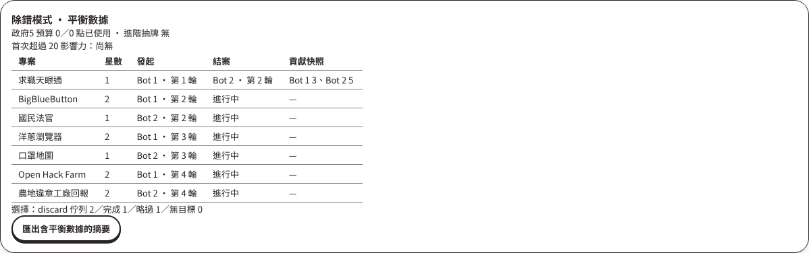
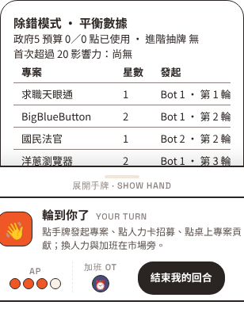

# Bot players — milestone 1 evidence

Runtime commit `c054221`, Node 22.22.0, 4 vCPU Linux container, 2026-10-27.

## Batch run

```sh
pnpm webapp bots --games 100 --seed evidence
```

300 games (100 each at 2/3/4 players, Balanced in every seat) finished in
**15.9 s** with **0 failed games**. Files: [summary.csv](summary.csv),
[summary.json](summary.json), one game export with telemetry
([game-evidence-4p-0.json](game-evidence-4p-0.json)) and its move log
([moves-evidence-4p-0.jsonl](moves-evidence-4p-0.jsonl)).

| Players | Score mean (min–max) | Winner avg | Completions | Hearts left | Tier 3/4/5 reach | Gov 5 used/budget |
| --- | --- | --- | --- | --- | --- | --- |
| 2 | 48.8 (29–69) | 52.9 | 4.3 | 2.8 | 1 / 0.62 / 0.02 | 0 / 0 |
| 3 | 47.9 (29–76) | 53.1 | 6.6 | 0.6 | 1 / 0.98 / 0.72 | 101 / 240 |
| 4 | 41.3 (24–58) | 47.7 | 7.7 | 0.1 | 1 / 1 / 0.96 | 119 / 511 |

For comparison, the three human exports in `../standard-poc/` scored 35–52 and
completed 6–7 projects.

## Observations (Balanced in every seat; not yet balance conclusions)

- **Start player never rotates.** Seat 0 starts every round: `G.playOrder`
  rotates, but `TurnOrder.CUSTOM_FROM` only reads it when a phase begins.
  Seat win rates are 2p `{0: 0.37, 1: 0.63}` and 4p
  `{0: 0.05, 1: 0.21, 2: 0.30, 3: 0.45}`. The same code is on `main`;
  tracked as a separate fix.
- **Only 1★/2★ projects complete, and no advanced card is drawn.** Balanced
  prefers the entry pile by design (`advancedDraw: -0.5`), so this says
  nothing yet about advanced reachability. That needs a strategy that wants them.
- **Government 5 uses 24–42% of its budget.** Most unused points have no legal
  target: the owner has no other cube with room. That matches the audit's open
  question about restricting it to existing cubes.
- **Source 4 rarely has a target** (49–53 of 225–306 queued). Finishers seldom
  have another engineer cube.
- **Tier 5 is almost never reached at 2 players** (2%), versus 72% at 3 and
  96% at 4.
- **government-2 (event preview) is never grown.** That is likely an artifact
  of its low initial `nodeImpact` guess (0.1).

## Telemetry privacy

`telemetry.test.ts` asserts telemetry is absent from every player and observer
view. In a live check (game server with `DEBUG_TELEMETRY=1`, Next dev server,
a 2-player match where Balanced bots made 25 moves over Socket.IO):

- `GET /debug/matches/<id>/telemetry` returned **200** with the telemetry and
  the configured CORS origin.
- The same request to a server without the flag returned **404**.
- `/game/<id>` without `?debug=1` rendered no debug panel (count 0); with
  `?debug=1` the panel rendered:




