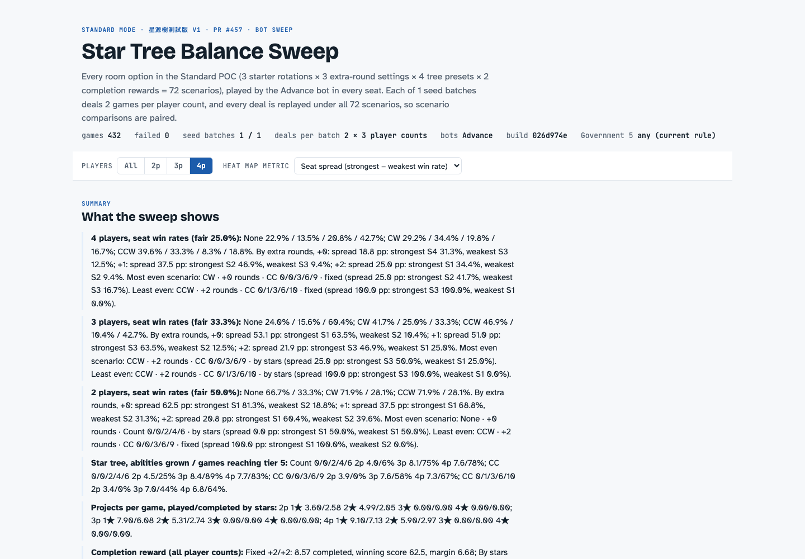
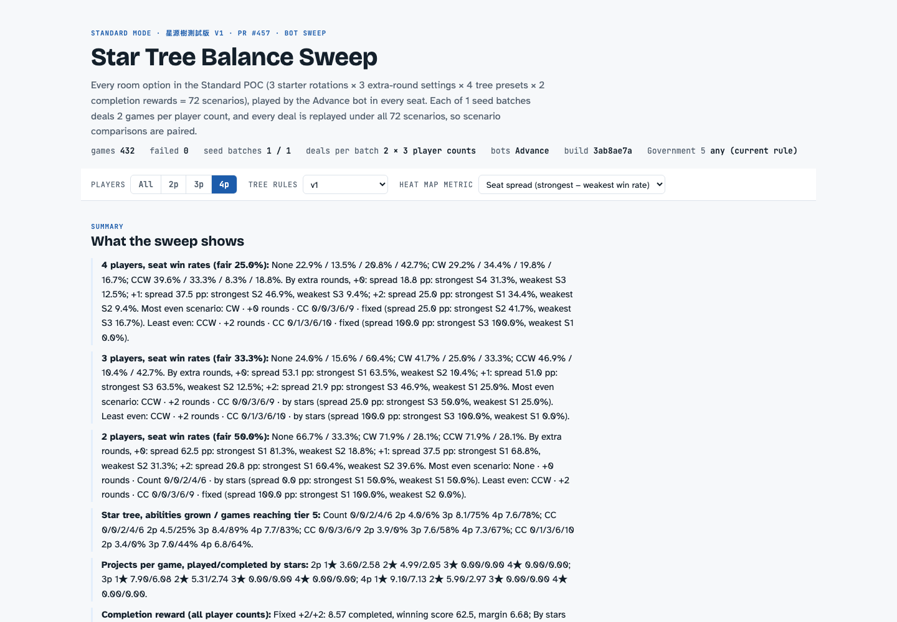
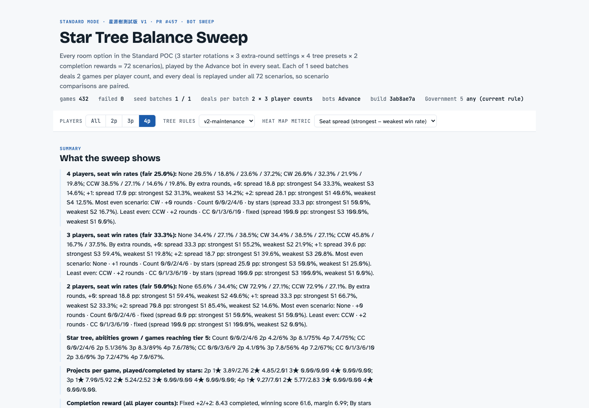

# Tree v2 bot and tooling verification

Verified 2026-10-29 at `3ab8ae7a1cc8253a663663684b00f45c44571608`, on macOS
arm64, Node 24, pnpm 11.15.1. The source tree was clean during the recorded
smoke run. This is compatibility and valuation evidence, **not a balance
study**. No large sweep was run.

## Results

| Command (repository root unless stated) | Observed result |
| --- | --- |
| `pnpm webapp build` | Exit 0; Next.js production build and server compilation passed |
| `pnpm webapp test` | Exit 0; 436 tests in 39 suites passed |
| `pnpm webapp exec tsc --noEmit` | Exit 0 |
| `pnpm webapp lint` | Exit 0; no warnings or errors |
| `pnpm webapp bots:smoke` | Exit 0; 216 scenarios × 2 seeds × 3 player counts = 1,296 games, 0 failures; analysis generated |
| `pnpm webapp bots:behaviour` | Exit 0; 9,000 v1 games, 0 failures; all 3 scenario/player-count cells match the recorded baseline exactly |
| `python3 packages/webapp/scripts/test_analyze_standard_sweep.py` | Exit 0; legacy v1 and both v2 subcases preserve the gate fields and distinct contract labels; zero score residual |

The 12 focused bot tests cover main jobs and tied/wildcard initiation, the
expanded connections, non-engineer Source 4 choices, advanced access at the
strict threshold, contracts on advanced versus entry projects, maintenance
horizon, and first-gate observation excluding final scoring. The v2 tests
assert valuations directly; they do not depend on the still-v1 engine
producing v2 outcomes.

A separate temporary scorer comparison loaded the unchanged evaluator from
`026d974e` and compared every enumerated candidate against the new evaluator
while playing one v1 game for each of Novice/Normal/Advance × 2/3/4 players,
using seeds `v1-values-2`, `v1-values-3`, `v1-values-4`. All **6,068 candidate
scores across 513 decisions** matched with strict numeric equality. No
baseline evaluator copy is retained in the application.

[Verification record](verification.json) also records assertions over all
1,296 smoke records: all 72 v1 scenario IDs match the historical manifest,
v1 record keys remain unchanged, only v2 records add `fg`, and all three
variants share the same player-count/seating/seed tuples.

## Report interaction

Reproduce against the smoke output:

```sh
python3 packages/webapp/scripts/report-standard-sweep.py packages/webapp/bot-runs/smoke
pnpm webapp exec node scripts/verify-standard-sweep-report.cjs bot-runs/smoke/report.html
```

Chromium, 1440×1000: selected v1, v2-collab and v2-maintenance. Each selection
restricted the report's scenario data to that rule, displayed 72 rows at
4 players, and retained one gate field per seat. No browser errors occurred.

Matched v1 report views use the same smoke data; the before renderer is from
`026d974e`, before the Tree rules control existed. The after renderer is from
`3ab8ae7a`. These small smoke samples must not be interpreted as win-rate or
balance estimates.

| Before | After |
| --- | --- |
|  |  |



## Integration limitations

- Base includes the interface PR #472, but not the engine PR #473. V2 smoke
  games therefore still exercise v1 engine mechanics with v2 bot estimates.
- Source 4 follows the confirmed rule in #473: the finisher advances one of
  their own existing cubes, of any job, on another project. The earlier
  any-player wording was a drafting error; no engine change is needed.
- Maintenance valuations assume completion this round and can overestimate
  delayed income. V2 node impact numbers are initial estimates.
- Existing workflows run only for PRs targeting `main`. This PR targets
  `feat/standard-tree-poc`, so local checks are recorded above and the PR
  remains draft; no GitHub CI pass is claimed.
- Deployment is pending the integrated, reviewed rules and bot branches.

## Own-cubes correction

The confirmed Source 4 rule is: the finisher may advance one of their own
existing cubes, of any job, on another project. The scorer excludes other
players' cubes and cannot create a new cube. The ownership tests cover both
v2 variants with an own non-engineer cube, a foreign target, and a missing
own cube.

Both v2 node impacts were reduced from 0.6 to **0.5 AP per round**. V1 remains
0.4: v2 removes the engineer/job and completion restrictions but still needs
an eligible own cube elsewhere. This is an initial conservative heuristic,
not a measured calibration. The earlier drafting error is resolved; #473
already implements the confirmed rule. No engine files were changed.

Reverified 2026-10-30 at `fbe51273` after the correction:

| Command | Observed result |
| --- | --- |
| `pnpm webapp build` | Exit 0; production client and server build |
| `pnpm webapp test` | 437 tests / 39 suites passed, including 13 focused v2 valuation/gate cases |
| `pnpm webapp exec tsc --noEmit` | Exit 0 |
| `pnpm webapp lint` | Exit 0; no warnings or errors |
| `pnpm webapp bots:smoke` | 1,296 games / 216 scenarios, 0 failures |
| `pnpm webapp bots:behaviour` | 9,000 games, 0 failures; all 3 cells exactly match the v1 baseline |

The screenshots and original verification record above retain their explicitly
identified earlier build; they demonstrate the unchanged report control.
